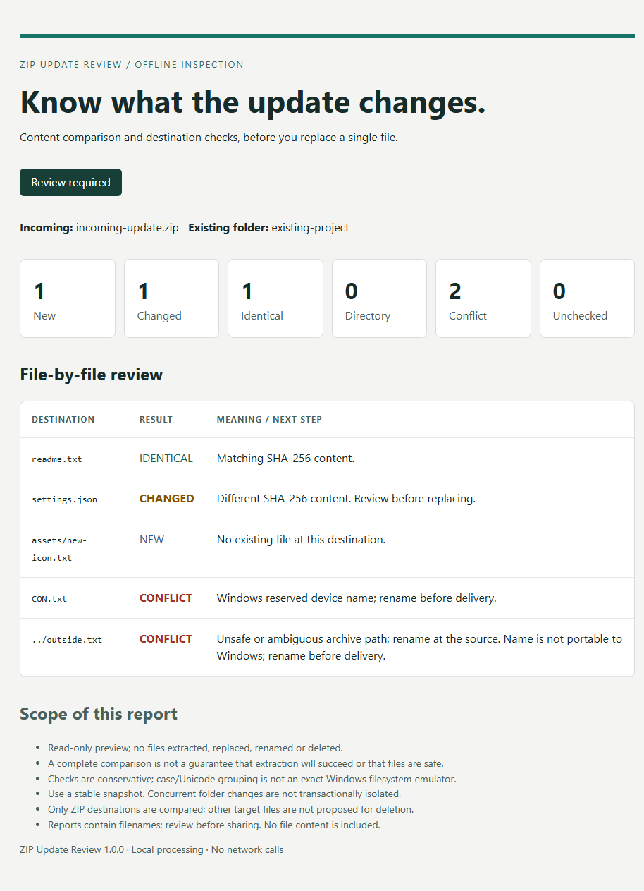

## ZIP Update Review — offline developer utility ($9)

Review how an incoming ZIP compares with an existing project folder before replacing files. This original, read-only Python command-line tool reports new, changed, identical and conflicting destinations, with HTML and JSON reports. The download includes source, usage instructions, tests, an MIT license and a synthetic sample report.

Requires Python 3.11+; Windows-tested. It does **not** extract, replace, back up or malware-scan files. The product was developed with AI assistance; no paid customer outcomes are claimed.

[View ZIP Update Review on Gumroad — $9 one-time](https://thepro2487.gumroad.com/l/pxvduy?utm_source=github&utm_medium=profile&utm_campaign=zip_update_review)

[See the synthetic report preview](zip-update-review/SAMPLE.md) · [Read the sample JSON](zip-update-review/sample-report.json).

### Questions before buying the ZIP tool?

[Ask a public ZIP Update Review compatibility question](https://github.com/dsdadaadsads-dev/dsdadaadsads-dev/issues/new?title=ZIP%20Update%20Review%20compatibility%20question&body=Public%20ZIP%20tool%20question%20only.%20Do%20not%20attach%20archives%2C%20reports%2C%20project%20source%2C%20local%20paths%2C%20personal%20data%2C%20order%2Fpayment%20details%20or%20credentials.%0A%0AOperating%20system%20%28generic%20version%29%3A%0APython%20version%20%28if%20known%29%3A%0AArchive%20format%2Fcompression%20%28if%20known%29%3A%0AWhat%20would%20you%20like%20to%20check%20before%20buying%3F%0A). A GitHub account is required. You can describe your operating system, Python version and archive format without sharing project files.

This board is public. Do not upload archives, reports, project source, local paths, personal data, order/payment details or credentials. For an existing Gumroad order or refund, use the support options in your purchase receipt. CSV and Roblox service inquiries belong in their Upwork project workflows.

Questions do not include custom integration, a live support service or a guaranteed response time. The tool's documented compatibility and limits still apply.

---

## CSV export validation — technical work sample

Two exports can look similar while containing duplicate or conflicting record IDs. This synthetic work sample shows how I report structural and stable-ID findings, record source-file SHA-256 evidence, and disclose report limits.

[View the synthetic PDF audit](CSV_AUDIT_SYNTHETIC_SAMPLE.pdf)

The demonstration uses synthetic data and AI-assisted development. It is not paid client work or evidence of customer results. The audit reports findings; it does not correct, clean or merge records. Source files remain unchanged.

My existing Upwork CSV Validation Audit covers up to two compatible UTF-8 CSV files, 1,000 combined records, 16 columns per file and 100 KiB per file. The approved package is $49, with two-day delivery and one bounded correction revision. It does not include general cleaning, record correction, platform migrations or financial reconciliation.

[See the existing package, terms and work sample on Upwork](https://www.upwork.com/services/product/development-it-a-professional-csv-export-report-with-duplicate-id-and-format-checks-2119040538064915396)

Please use the Upwork project workflow for any inquiry or purchase. Do not put private customer files, credentials or financial information in GitHub issues.

## Product export comparison - separate synthetic capability sample

[View an original product-export comparison demonstration](samples/product-export-comparison-v46/README.md): changed prices/stock, missing keys, duplicate ambiguity and invalid values, with synthetic inputs and source hashes. AI-assisted; no customer data, store connection or customer-result claims.

This comparison is separate from the existing $49 structural CSV audit and is not included in that package. Any custom work requires separate scope, privacy, timeline and price qualification through the appropriate marketplace workflow.
