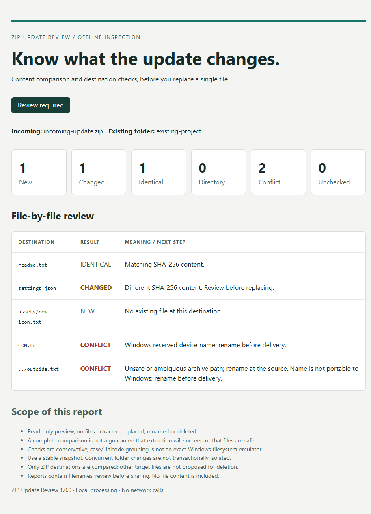

# Preview a ZIP update before replacing files

An incoming update contains `settings.json`. Your project already has a file with that name. Is it identical, changed, or blocked by a destination conflict?

ZIP Update Review compares a local ZIP with an existing local project copy. The original synthetic example shows:

| ZIP destination | Result | Why it matters |
| --- | --- | --- |
| readme.txt | Identical | SHA-256 content matches. |
| settings.json | Changed | Compare the update before replacing your current file. |
| assets/new-icon.txt | New | There is no existing file at that destination. |
| CON.txt | Conflict | Windows reserves this device name. |
| ../outside.txt | Conflict | The path escapes the intended ZIP destination. |

The tool writes a readable HTML report and JSON. It does not extract or replace input files. It is a Python command-line utility, Windows-tested, with explicit resource and format limits. It is not a malware scanner, backup system or deployment tool. Free comparison software such as WinMerge may already meet your needs.

The demonstration uses original generated fixtures. No client data, testimonials, measured time savings or sales are represented. Code and copy were created with AI assistance and independently reviewed.

[Read the synthetic sample JSON](sample-report.json).

[ZIP Update Review on Gumroad — $9 one-time](https://thepro2487.gumroad.com/l/pxvduy). Requires Python 3.11+ and terminal use; Windows-tested. Includes MIT-licensed source, instructions, tests and this synthetic report.
